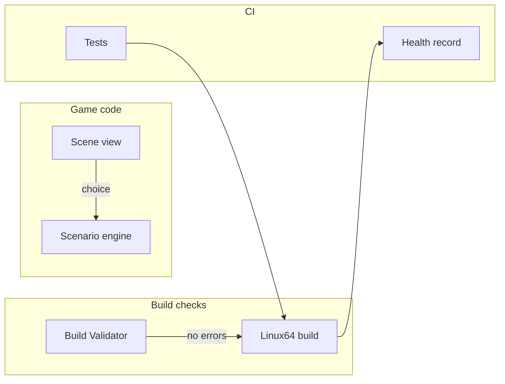

# BuildGuard

BuildGuard is a developer-productivity toolkit for a Unity team. The sample content is a short welfare-check training scenario. The project around it is the part worth reading: game rules that can be unit tested, a build check that stops a bad player from being produced, and a pipeline that records whether each change is healthy.

## The idea

A training scenario is a small state machine. It has steps, the trainee picks a choice, and the engine scores the decision and reports an outcome: needs coaching, satisfactory, or exemplary. That logic is plain C#, with no Unity calls. One `MonoBehaviour` draws the prompt and the buttons and forwards the choice id. The scene is a camera, a light, and two primitives.

Because the rules are ordinary C#, an EditMode test can reject a bad score or a broken choice without opening the scene. A PlayMode test only checks that the scene loads and that one full path finishes.

The same split is used for the build. The validator checks three things: scenes missing from Build Settings, missing scripts on prefabs and scenes, and textures over a size budget. The checks are pure functions of a snapshot of the project, so they are unit tested without planting a broken asset in the repo. Errors fail the build before the player is compiled. Warnings are counted and do not stop it.

Every push runs the tests, then the Linux player build, then writes one JSON record: duration, pass and fail counts, validator warnings, and the commit. A static page plots that history.

## What a reader should take from it

- Game rules and Unity presentation are separate, so the rules have fast tests.
- Build health is a set of small checks with a shared report, not a script that only the CI job knows about.
- The pipeline fails when the tests fail or the validator reports an error, and it keeps the player, the test results, and the coverage as artifacts.
- Build health over time is a file in the repo and a page, not a dashboard product.

## How it fits together

## Where to look

| If you want | Open |
| --- | --- |
| The scoring rules | `Assets/BuildGuard/Runtime/Scenario` |
| The sample scenario | `Assets/BuildGuard/Runtime/Training/CommunicationScenario.cs` |
| The build checks | `Assets/BuildGuard/Editor/Validation` |
| The tests | `Assets/BuildGuard/Tests` |
| The pipeline | `.github/workflows/ci.yml` |
| The health page | `docs/dashboard` |

Unity **6.3 LTS** (`6000.3.29f1`). C#, Unity Test Framework, GameCI on GitHub Actions.

Engineers opening the project, wiring the Unity license, or adding a check should use [docs/SETUP.md](docs/SETUP.md). The file map is in [CONTRIBUTING.md](CONTRIBUTING.md).

## License

MIT. See `LICENSE`.
