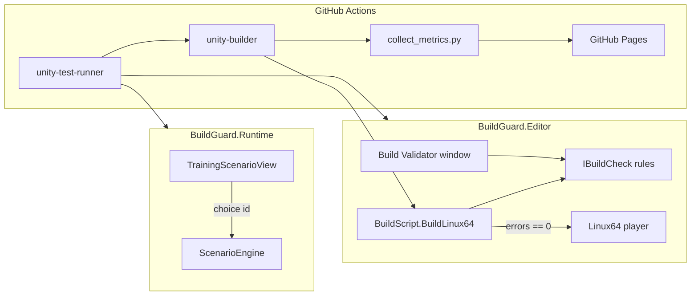

# BuildGuard

BuildGuard is a small Unity project and the CI around it. The sample is a public-safety communication scenario: a welfare check with a few choices, a score, and a coaching band. The point of the repo is not the scene. It shows how to keep game rules testable, fail a build before a broken player is produced, and make that result visible after every run.

It is aimed at internal developer-productivity work: pipeline, build checks, test automation, and a health dashboard for a Unity C# codebase.

[](https://github.com/Pcdesai11/BuildGuard/actions/workflows/ci.yml)

Replace `Pcdesai11` and `BuildGuard` after you create the GitHub repository. The badge stays neutral until the workflow has run on `main`.

## Unity version

**Unity 6.3 LTS, `6000.3.29f1` (changeset `96d2fe17529c`).**

Unity publishes one LTS a year and supports it for two years. 6.3 LTS is the current long-term line (through December 2027; Enterprise and Industry get an extra year). 6.0 LTS left standard support in October 2026. 6.6 is a supported update release, not the LTS, so a team that wants a stable editor image should pin 6.3. `6000.3.29f1` is the patch released 19 November 2026, and GameCI published a matching Linux editor image the same day: `unityci/editor:ubuntu-6000.3.29f1-linux-il2cpp-4`.

The player scripting backend in `ProjectSettings/ProjectSettings.asset` is IL2CPP for Standalone (`scriptingBackend.Standalone: 1`). `0` is Mono and `1` is IL2CPP. GameCI's StandaloneLinux64 image suffix is `linux-il2cpp`, and that is the image Docker Hub has for this exact editor version. Mono is still a documented Linux backend, but this CI image is the IL2CPP toolchain, so the project setting matches the image the builder will pull.

## Architecture

The scenario rules do not call Unity. The only MonoBehaviour asks the engine what the current step is and forwards a choice id. The build checks do not call `AssetDatabase` either. A runner takes a snapshot of the project, and the checks are pure functions of that snapshot. CI is the only place that joins test results, the validator report, and the clock.



Why the split: a PlayMode test has to boot the editor, and an EditMode test of the rules does not. Keeping the score calculation in plain C# means a bad threshold is a 30 millisecond failure instead of an import.

## Repository map

`CONTRIBUTING.md` walks through every file. The short version:

| Path | Role |
| --- | --- |
| `Assets/BuildGuard/Runtime` | Scenario model, engine, sample content, and the one scene view |
| `Assets/BuildGuard/Editor` | Validator, editor window, and `BuildScript.BuildLinux64` |
| `Assets/BuildGuard/Tests/EditMode` | Rules and validator snapshots, plus one scan of this project |
| `Assets/BuildGuard/Tests/PlayMode` | Scene load, and a full run of the best path |
| `Assets/BuildGuard/Scenes/TrainingScenario.unity` | Camera, light, floor, cube, and the view |
| `.github/workflows/ci.yml` | Test, Linux64 build, metrics, Pages |
| `ci/collect_metrics.py` | Turns NUnit XML and the validator JSON into one history record |
| `docs/dashboard` | Static page. Reads `history.json`. No build step |

## Run it locally

1. Install **Unity 6000.3.29f1** with the **Linux Build Support (IL2CPP)** module. Hub → Installs → install that exact version, or add the module later from the same row.
2. Add the project folder with **Add project from disk**. The first open rewrites `ProjectSettings` and creates `Packages/packages-lock.json`. Commit both. That lock file is how the next machine resolves the same packages.
3. Open `Assets/BuildGuard/Scenes/TrainingScenario.unity` and press Play. The floor and cube are primitives. The view builds the prompt and the buttons in code.
4. Window menu: **BuildGuard → Open Build Validator**, then **Run validation**. Errors would fail a player build. Warnings are reported and do not.
5. Optional budget: **BuildGuard → Validation Settings** creates `Assets/BuildGuard/Editor/BuildValidationSettings.asset`. The default is 2048×2048. That number is a policy default, not a measurement from a build.

### Tests in the editor

**Window → General → Test Runner.** EditMode is the scenario and the validator. PlayMode loads `TrainingScenario`. The scene has to stay enabled in **File → Build Profiles** (Build Settings). The PlayMode test loads it by name.

From a shell, with `UNITY` set to the editor binary:

```bash
# macOS
UNITY="/Applications/Unity/Hub/Editor/6000.3.29f1/Unity.app/Contents/MacOS/Unity"
# Windows
# UNITY="C:/Program Files/Unity/Hub/Editor/6000.3.29f1/Editor/Unity.exe"
# Linux
# UNITY="$HOME/Unity/Hub/Editor/6000.3.29f1/Editor/Unity"

"$UNITY" -batchmode -nographics -projectPath . \
  -runTests -testPlatform EditMode \
  -testResults artifacts/editmode-results.xml -logFile -

"$UNITY" -batchmode -nographics -projectPath . \
  -runTests -testPlatform PlayMode \
  -testResults artifacts/playmode-results.xml -logFile -
```

Coverage from the same editor, after the Code Coverage package is imported:

```bash
"$UNITY" -batchmode -nographics -projectPath . \
  -runTests -testPlatform EditMode \
  -enableCodeCoverage \
  -coverageResultsPath CodeCoverage \
  -coverageOptions "generateAdditionalMetrics;generateHtmlReport;assemblyFilters:+BuildGuard.Runtime,+BuildGuard.Editor" \
  -testResults artifacts/editmode-results.xml -logFile -
```

### Player build from the command line

`BuildScript.BuildLinux64` runs the validator first. Exit code 1 means the validator found errors and the player was not started. Exit code 2 means the player build failed. Exit code 0 means both passed.

```bash
"$UNITY" -batchmode -nographics -quit -projectPath . \
  -executeMethod BuildGuard.Editor.BuildScript.BuildLinux64 \
  -buildTarget StandaloneLinux64 \
  -customBuildPath build/StandaloneLinux64/BuildGuard \
  -logFile -
```

Reports land in `BuildReports/`, which is gitignored:

- `build-validation.json` — errors, warnings, and the message for each finding
- `player-build.json` — written only if a player build was attempted

## GitHub secrets

GameCI does not store your Unity account. The action reads three secrets at job time. The steps below match the [GameCI activation doc](https://game.ci/docs/github/activation/) as checked for this repo.

Use the **Personal** path or the **Pro** path, not both. Sending `UNITY_LICENSE` and `UNITY_SERIAL` together makes activation pick the wrong method.

### Personal license

1. Install Unity Hub and sign in with the account CI should use.
2. **Unity Hub → Preferences → Licenses → Add → Get a free personal license.** Click through Add even if a license already appears. Hub can show a seat without writing a `.ulf` file.
3. Copy the whole file, including the XML:
   - Windows: `C:\ProgramData\Unity\Unity_lic.ulf`
   - macOS: `/Library/Application Support/Unity/Unity_lic.ulf`
   - Linux: `~/.local/share/unity3d/Unity/Unity_lic.ulf`
4. On GitHub: **Settings → Secrets and variables → Actions → New repository secret.**

   | Secret | Value |
   | --- | --- |
   | `UNITY_LICENSE` | The entire `.ulf` file. Not a path. Not base64. |
   | `UNITY_EMAIL` | The Unity ID email |
   | `UNITY_PASSWORD` | The Unity ID password |

5. Sign out of Hub when you are done copying. Hub 3.7 and later has no "Return license" for a Personal seat. Signing out returns it. If the seat stays checked out on your laptop, CI activation fails because the seat is already in use.
6. Use a password made of letters and numbers. GameCI has seen activation fail when the password contains symbols, because the value is passed into the editor container.

### Professional license

Return the seat in Hub first (**Preferences → Licenses → Return license**) so you do not hold two seats. Then create:

| Secret | Value |
| --- | --- |
| `UNITY_SERIAL` | The serial from the Unity subscription page, shaped like `XX-XXXX-XXXX-XXXX-XXXX-XXXX` |
| `UNITY_EMAIL` | Unity ID email |
| `UNITY_PASSWORD` | Unity ID password |

In `.github/workflows/ci.yml`, remove `UNITY_LICENSE` from both jobs and add `UNITY_SERIAL: ${{ secrets.UNITY_SERIAL }}` next to the email and password. Do not leave `UNITY_LICENSE` in the `env` block.

### What else has to be turned on

- **Settings → Actions → General → Workflow permissions → Read and write.** The test job posts a check run. The metrics job pushes `docs/dashboard/history.json`. A read-only token fails both.
- **Settings → Pages → Build and deployment → Source → GitHub Actions.** The dashboard is not a branch deploy. The metrics job uploads `docs/dashboard`.
- Fork pull requests cannot read these secrets. That is GitHub's rule, not a missing setting. CI on a fork PR fails at activation. Same-repo branches can.

Push to `main` once those three secrets exist. The first run is cold: it pulls an editor image of several gigabytes and compiles the IL2CPP player. Later runs restore `Library`.

## What CI does

On every push to `main` and every pull request:

1. **Test** runs EditMode and PlayMode (`testMode: all`) with `game-ci/unity-test-runner@v4`. Coverage is on for `BuildGuard.Runtime` and `BuildGuard.Editor`. The coverage HTML is an artifact. Coverage does not fail the job.
2. **Build** runs only if tests passed. `game-ci/unity-builder@v4` calls `BuildGuard.Editor.BuildScript.BuildLinux64`, which writes the validator report and, when there are zero errors, builds a Linux64 player.
3. **Metrics** reads the NUnit XML, the validator JSON, and the job clocks. On a push to `main` it appends one record to `docs/dashboard/history.json` and deploys `docs/dashboard` to Pages. Pull requests upload a `run-metrics` artifact and do not change the public chart.

The actions are pinned to `@v4` because that is the line the current GameCI test-runner and builder docs describe, and because `unity-builder` v6 has an open checkout failure (`game-ci/unity-builder#856`) that does not reproduce on v4. Both actions also set `containerRegistryImageVersion: "4"`. The action's own default is still `"3"`, but `6000.3.29f1` was published after GameCI moved new editors to image generation 4 (Ubuntu 24.04, 17 November 2026). There is no `-3` Linux image for this patch. Leaving the default makes the job fail with "Unable to find image" before Unity starts.

`actions/cache@v4` stores `Library`. The key includes a hash of `Assets`, `Packages`, and `ProjectSettings`, which is what the GameCI builder doc recommends: a cache entry is immutable, so a changed project needs a new key or the next run restores a stale Library and never saves a better one. `restore-keys` falls back to the newest `Library-BuildGuard-v1-` entry when the exact key misses. Bump the `v1` prefix if a restored Library starts failing import; that discards the bad cache without deleting anything by hand.

Artifacts on a finished run:

| Artifact | What it is |
| --- | --- |
| `test-results` | NUnit XML for EditMode and PlayMode |
| `coverage-report` | HTML and XML coverage |
| `linux64-player` | The player, only when the build step succeeded |
| `build-reports` | `build-validation.json`, `player-build.json`, build-job timing |
| `run-metrics` | The one JSON object that was appended, or would have been |

A metrics commit only touches `docs/dashboard/history.json`. The workflow ignores that path, so the commit does not start another run.

## Add a validator check

The checks live behind `IBuildCheck` so the window and `BuildScript` do not grow a new `if` for every rule.

1. Add a class next to the others in `Assets/BuildGuard/Editor/Validation/BuildChecks.cs` (or its own file in that folder). Implement `Id`, `Description`, and `Evaluate`.
2. If the check needs data the snapshot does not have yet, add a field to `ValidationContext` and fill it in `BuildValidationRunner.Capture`. Do not call `AssetDatabase` from `Evaluate`. The EditMode tests construct a context by hand.
3. Register the instance in `BuildCheckCatalog.CreateDefault`. That is the list both the window and CI run.
4. Add an EditMode test in `BuildValidatorTests` that passes a small context and asserts the severity. Decide explicitly whether the finding is an error. Errors fail `BuildLinux64` before `BuildPipeline.BuildPlayer`. Warnings are counted and do not stop the player.

Current rules:

| Id | Error | Warning |
| --- | --- | --- |
| `scene-build-list` | Enabled scene file is missing, or the enabled list is empty | Scene asset is not enabled, or the same scene is enabled twice |
| `missing-scripts` | A prefab or enabled scene has a missing MonoBehaviour | — |
| `texture-budget` | Width or height budget is not positive | Imported size is strictly over the budget |

An unlisted scene is a warning because sandboxes and test scenes are normal. An empty build list is an error because the player would contain nothing. A missing script is an error because the object looks present and does nothing in the player.

## Dashboard

The page is static HTML, CSS, and JS in `docs/dashboard`. It fetches `history.json` next to itself. There is no chart library and no account.

Locally:

```bash
python3 -m http.server 47321 --directory docs/dashboard
```

Open `http://127.0.0.1:47321`. With an empty history the page says no runs are recorded. **Preview with sample data** draws a chart from numbers generated in the browser. That preview is labeled and is not written to `history.json`.

After the first green push to `main`, the site is `https://Pcdesai11.github.io/BuildGuard/`. The history file on `main` is the source of the chart. Pull-request runs stay in the `run-metrics` artifact so a branch cannot rewrite the trend.

Each record has the commit SHA, the run URL, test passed/failed/skipped, validator errors and warnings (or `ran: false` when the build job did not produce a report), the test-job and build-job durations, and the player-build duration from Unity's `BuildReport` when a player was attempted. A skipped build is stored as `not-run`, not as zero warnings. `ci/test_collect_metrics.py` locks that distinction. The test imports `collect_metrics`, so run it from that directory:

```bash
cd ci && python3 -m unittest test_collect_metrics.py -v
```

## How to investigate a failing run

Open the red workflow from the commit, or from the run link on the dashboard once a record exists. The failing job tells you which layer broke. Do not start by rebuilding locally.

1. **The job dies before "Run EditMode and PlayMode tests" or "Validate and build".** This is activation or the editor image, not your C#. Search the log for `Licensing` and `Unable to find image`.
   - `Code 400` / `TimeStamp validation failed` on Unity 6.3 Personal `.ulf` files is a known GameCI failure (`game-ci/unity-test-runner#336`, still open as of October 2026). It happens before import. Regenerating the `.ulf` and signing out of Hub is the first check. If a fresh file still fails, the project is not misconfigured; the upstream license client is rejecting `-manualLicenseFile` for that editor line. A Pro serial (`UNITY_SERIAL`, and no `UNITY_LICENSE`) uses a different activation path.
   - `No seats` or `license has not been activated`: the Personal seat is still checked out in Hub. Sign out of Hub and re-run.
   - `Unable to find image` with a tag ending in `-3`: `containerRegistryImageVersion` was reset to the action default. This repo pins `"4"` because that is the tag Docker Hub has for `6000.3.29f1`.
2. **The test job is red.** Download the `test-results` artifact and open the XML. Each failure has a `<failure>` message and a stack. EditMode failures are assertion messages from `Assets/BuildGuard/Tests/EditMode`. PlayMode failures usually mean the scene did not load: confirm `TrainingScenario` is enabled in Build Settings and the script guid on the view still matches `TrainingScenarioView.cs.meta`.
3. **The build job is red and `build-validation.json` has `errorCount` above zero.** The player was not started. The `message` and `assetPath` on each issue say which check fired. Fix the asset or, if the check is wrong, change the rule and its test together. Warnings do not fail this step; if the only findings are warnings, the failure is in the player build itself.
4. **The build job is red and the validator passed.** Search the job log for `error CS` or `BuildFailedException`. The editor log is printed by GameCI in the job. IL2CPP failures are usually a missing Linux IL2CPP module in the image (the pin above is what selects it) or a script that does not compile for the player. Player scripts are `BuildGuard.Runtime`. Editor scripts are not in the player.
5. **Tests and the build are green, the dashboard did not move.** The metrics job runs on pushes to `main` only. Confirm Workflow permissions are read and write, and that the metrics commit was not rejected by branch protection. Pages deploy is allowed to fail without failing the workflow, so a missing Pages source shows up as a warning on that step, not as a red test. Set Pages to GitHub Actions and re-run the workflow.
6. **A restored Library fails import in a way a clean run does not.** Change the cache prefix in `ci.yml` from `Library-BuildGuard-v1-` to `v2`. The next run misses and saves a new Library. Do not commit `Library/`.

## Measured results

Fill this in from a real run on `main`. Leave the cells as they are until then.

| Measurement | Cold run | Cached Library run | Run URL |
| --- | --- | --- | --- |
| Test job duration | pending | pending | pending |
| Build job duration | pending | pending | pending |
| Player build duration (`player-build.json`) | pending | pending | pending |
| EditMode passed / failed | pending | pending | pending |
| PlayMode passed / failed | pending | pending | pending |
| Validator errors / warnings | pending | pending | pending |

The dashboard is the same data over time. One row here is enough to talk about cold versus cached cost.

## Lessons learned / troubleshooting

- **The first open rewrites files.** Unity upgrades `ProjectSettings` and writes `Packages/packages-lock.json`. Commit that. CI should resolve the lock you opened, not whatever the registry serves next month.
- **Package versions are pinned to this editor.** `com.unity.test-framework` 1.4.6 is what 6000.3 projects resolve. `com.unity.testtools.codecoverage` 1.3.0 is the release Unity documents for 6000.3. `com.unity.ugui` 2.0.0 is the core uGUI package. If the editor reports a core package version mismatch, let it rewrite `Packages/manifest.json` and commit the result. Do not guess a newer version.
- **Coverage files are owned by root** inside the GameCI container. The workflow chmods the coverage directory before upload. If the coverage artifact is empty and the tests passed, the chmod step is the first place to look, then `steps.tests.outputs.coveragePath`.
- **A validator warning is not a failed build.** The JSON still carries `warningCount`. The dashboard plots that. Failing the build on every unlisted scene trains people to disable the check.
- **`history.json` commits do not re-trigger CI** because of `paths-ignore`. If you change the workflow in the same commit as the history file, the ignore does not apply: GitHub only skips the workflow when every changed file matches. Don't mix them.
- **Two pushes close together can both try to append history.** The metrics job rebases onto `origin/main` before pushing. If the push still loses, re-run the newer workflow. The collector replaces a record with the same commit SHA and run id, so a re-run does not duplicate a point.
- **Cancelling an older run drops it from the chart.** `cancel-in-progress` is on so a new push does not wait behind a doomed IL2CPP build. The chart contains runs that finished.
- **Do not commit `Library/`, `BuildReports/`, `artifacts/`, or `CodeCoverage/`.** They are machine output. The gitignore already excludes them.

## License

The code in this repository is MIT. See `LICENSE`. Unity and GameCI are their own projects; this repo is not affiliated with Unity Technologies or Axon.
